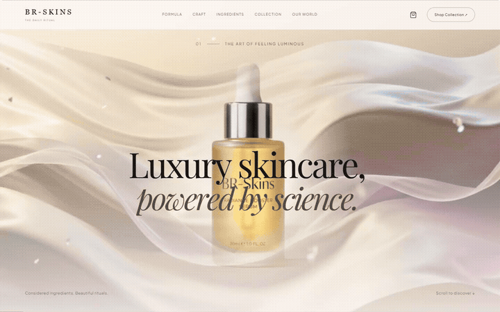

<div align="center">

# BR-Skins

### A cinematic, scroll-driven skincare experience

Next.js · TypeScript · Three.js · React Three Fiber · GSAP · Lenis



[Watch the 35-second showcase](docs/media/BR-Skins-Showcase.mp4) · [Getting started](#getting-started) · [Explore the experience](#the-experience)

</div>

BR-Skins is a luxury skincare website concept where scrolling controls the story. Product footage, interactive 3D bottles, and editorial layouts come together across nine sections, with responsive desktop and mobile presentations.

## The experience

| Scene | What happens |
| --- | --- |
| Hero | A cinematic product introduction with scroll-synced footage |
| Bottle anatomy | An exploded bottle reveal with tracked annotations |
| Ingredients | Floating ingredient spheres and interactive information cards |
| Liquid transformation | A scroll-controlled fluid-to-bottle transition |
| Collection | A five-product 3D carousel and shopping bag interaction |
| Lifestyle | Editorial imagery and product storytelling |
| Why BR-Skins | Brand features and benefits |
| Testimonials | A concept customer-review presentation |
| Finale | An interactive 3D product closing scene |

This is a frontend portfolio concept. Product claims and testimonials are demonstration content. The shopping bag is client-side; checkout, payment processing, accounts, and order fulfillment are not connected.

## Getting started

Use Node.js 20 or newer and npm.

```bash
git clone https://github.com/AHMEDALIGHORI/BR-Skins.git
cd BR-Skins
npm ci
npm run dev
```

Open [localhost:3000](http://localhost:3000). No environment variables or API credentials are required for the local experience.

For a production build:

```bash
npm run build
npm start
```

For a TypeScript check:

```bash
npx tsc --noEmit
```

## Built with

- **Next.js 14 and React 18** for the application and component structure.
- **TypeScript and Tailwind CSS** for typed components and styling.
- **Three.js, React Three Fiber, and Drei** for the interactive product scenes.
- **GSAP ScrollTrigger and Lenis** for coordinated scrolling and pinned sections.
- **Framer Motion** for interface transitions.

## Project structure

```text
src/
  app/                 App entry point, layout, and global styles
  components/
    canvas/            3D bottles, scene objects, and fluid effects
    sections/          Nine sections and footer
    ui/                Navigation, loader, scroll video, and shopping bag
  lib/                 Products, scene helpers, sound, and annotation tracking
  types/               Shared TypeScript types
public/assets/         Project images and video footage
docs/media/            Animated README preview and showcase video
```

## Media and performance

The website includes the supplied project images and five video clips in `public/assets`. Scroll position controls video playback; 3D scenes complement the footage. The README animation and showcase were captured from the actual website.

WebGL support is required for the full 3D presentation. Animation performance depends on the device, browser, and GPU. Test on target devices before a production launch.

## Author

Created by [Ahmed Ali Ghori](https://github.com/AHMEDALIGHORI).

No open-source license is granted by this repository. Please contact the author before reusing the code or media.
